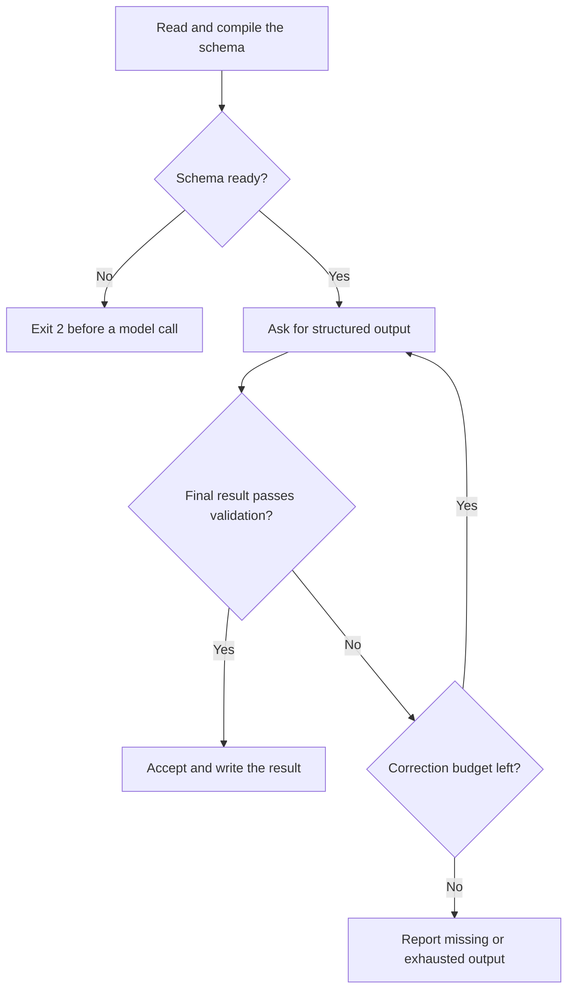
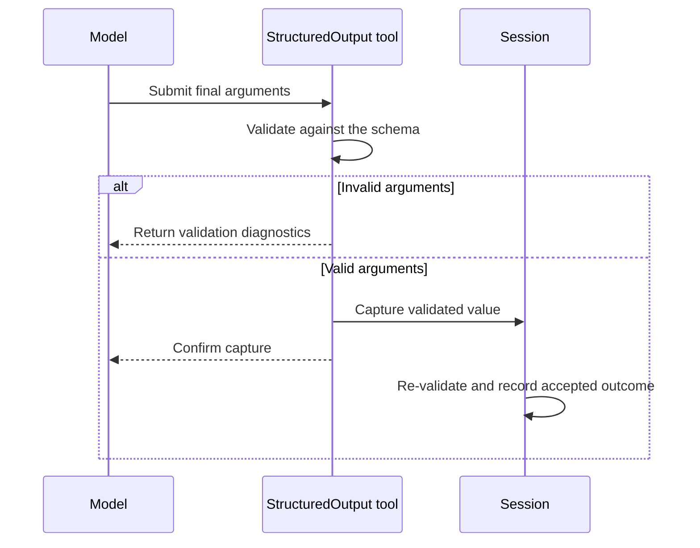

# explain-change

A free, MIT-licensed skill for understanding a pull request, commit range or completed design change. It reads the change and surrounding code at the revision you specify, explains the design, and points you to the files and tests behind it. [Read the skill instructions](SKILL.md)

## Try it in Claude Code

```sh
npx skills add aictrl-dev/skills --skill explain-change -a claude-code
```

Open the repository in Claude Code and run `/explain-change https://github.com/aictrl-dev/cli/pull/129`. Ask for a reviewer walkthrough with a Mermaid diagram and commit-pinned source links.

## Example from a real pull request

[CLI PR #129](https://github.com/aictrl-dev/cli/pull/129) adds a JSON Schema contract for the final result. The examples below show two views of the same change at commit `487f616`.

### Which paths reach the result file?

With schema enforcement enabled, the CLI checks the schema before calling the model. The session validates the final result and allows a bounded number of corrections. With `--output-result` set, only an accepted value reaches the file writer.



Trace the decisions in the code at the explained commit.

| Step | Code |
| --- | --- |
| Prepare the schema | [CLI preflight](https://github.com/aictrl-dev/cli/blob/487f616c50ab6be7bd652b0567069b2ab7c40057/packages/cli/src/cli/cmd/run.output.ts#L9-L52) |
| Count rejections and stop when the budget is spent | [Charge an attempt](https://github.com/aictrl-dev/cli/blob/487f616c50ab6be7bd652b0567069b2ab7c40057/packages/cli/src/session/prompt.ts#L726-L746) · [End the session](https://github.com/aictrl-dev/cli/blob/487f616c50ab6be7bd652b0567069b2ab7c40057/packages/cli/src/session/prompt.ts#L871-L888) |
| Accept a valid result | [Final validation](https://github.com/aictrl-dev/cli/blob/487f616c50ab6be7bd652b0567069b2ab7c40057/packages/cli/src/session/prompt.ts#L846-L857) · [Atomic result write](https://github.com/aictrl-dev/cli/blob/487f616c50ab6be7bd652b0567069b2ab7c40057/packages/cli/src/cli/cmd/run.output.ts#L54-L63) |

### Why validate twice?

The tool checks the arguments when the model submits them. The session checks the captured result again before recording success.



[Tool validation and capture](https://github.com/aictrl-dev/cli/blob/487f616c50ab6be7bd652b0567069b2ab7c40057/packages/cli/src/session/prompt.ts#L1122-L1146) · [Session acceptance](https://github.com/aictrl-dev/cli/blob/487f616c50ab6be7bd652b0567069b2ab7c40057/packages/cli/src/session/prompt.ts#L846-L857)

## Explore the same example in aictrl

The standalone skill produces Markdown with Mermaid fences and commit-pinned source links. In aictrl, select a step to see its code or the lines changed by the PR. [Open the interactive example](https://aictrl.dev/features/explain-pr#pr-replica)
